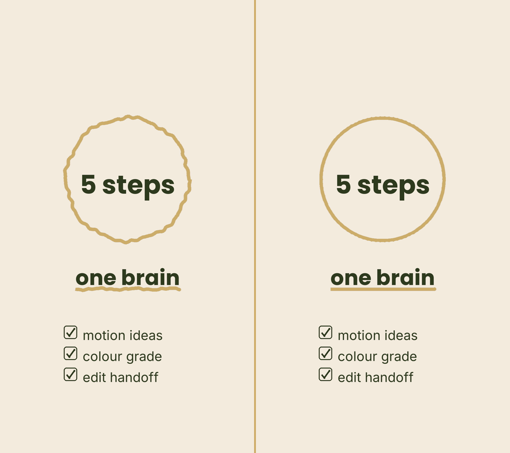

# Turn your computer into your team's editing brain

Editors text it on Telegram for motion graphics and colour grading.


You can edit with Claude. You shouldn't. Your job is the idea, the story and the yes or no on the cut. So instead of learning to edit with AI yourself, you set the AI up once on your own computer and let your editors use it through a chat.

That's what this kit is. Six Claude Code skills that live on your computer. Your editors and your manager don't install anything. They text a Telegram bot, it runs on your machine, and the files come back in your style.

## One brain, not five

```
            ┌──────────────────────────────────────────┐
            │   YOUR COMPUTER  =  THE BRAIN            │
            │   Claude Code + editor-ai-kit            │
            │   your brand style + your playbook       │
            │   motion graphics and colour grading     │
            └─────────────────────┬────────────────────┘
                                  │
                              Telegram
                                  │
          ┌───────────────────────┼───────────────────────┐
          │                       │                       │
     ┌────┴─────┐            ┌────┴─────┐            ┌────┴─────┐
     │ Editor 1 │            │ Editor 2 │            │ Manager  │
     │ texts it │            │ texts it │            │ texts it │
     └──────────┘            └──────────┘            └──────────┘
```

If every editor runs their own Claude, you've got separate brains. They drift, and your style comes out slightly different every time. When the brain lives on your computer, every change you make (a new look, a better prompt, a new step in your playbook) reaches every editor straight away. And not everyone on your team is good with AI. Everyone can send a text.

Want an editor to have their own AI subscription anyway? You can. Just know you're running two brains from then on.

## Install

Inside Claude Code, on your own computer:

```
/plugin marketplace add markzubovskyy-png/editor-ai-kit
/plugin install editor-ai-kit@editor-ai-kit
```

Or from the terminal:

```bash
git clone https://github.com/markzubovskyy-png/editor-ai-kit && cd editor-ai-kit && ./install.sh
```

`install.sh` copies the six skills into `~/.claude/skills/`. Run it again any time to update.

## The five step setup

**Build the brain (on your computer, once)**

1. **Install Claude Code on your own computer.** It's the tool the whole setup runs on, and it comes with a paid Claude plan. Get it at [code.claude.com](https://code.claude.com/docs/en/quickstart).
2. **Install the editor kit.** One of the two install options above.
3. **Teach it your look.** In Claude Code say "run brand style". It asks for your colours, your fonts, two or three creators you like and your default colour look, then writes one style file. Every graphic and every grade reads it first.

**Give your editors the chat**

4. **Create a Telegram bot and give your editors access.** Say "run telegram setup". It walks you through making the bot with BotFather, connecting it to Claude Code with Anthropic's official Telegram plugin, and adding each editor's Telegram user ID. Only the people you add can use it. Keep your computer on while they're working.
5. **Your editors text it.** They send the script or the clip and ask for what they need. Motion graphics come back as transparent files, colour grades come back as finished clips. Nothing to install on their side.

## What your editor actually sends

```
here's the script, give me motion graphics ideas
love 1 and 3, make them hand drawn
colour options for this clip
go with cinematic
pack everything for the edit
```

## The six skills

| Skill | What it does |
|---|---|
| `brand-style` | Short interview, writes `brand/style.md`: two colours, two fonts, reference creators, motion vibe, default grade. |
| `motion-ideas` | Reads a script or transcript and proposes 3 to 5 numbered motion graphic moments, each tied to the exact line. Never invents numbers. |
| `motion-render` | Renders each idea as a transparent 1080x1920 overlay: `.mov` ProRes 4444 with alpha, `.webm` VP9 with alpha, and a preview `.mp4`. Two styles: `clean` and `hand-drawn` (a boiling marker line). |
| `colour-grade` | Sends a 4 up options still per clip (warm, cold, cinematic, rec709), then renders the pick or matches a reference still you send. Writes the `.cube` LUT too. |
| `telegram-setup` | Sets up the bot on your computer with Anthropic's official Telegram channel plugin and allowlists your editors. |
| `edit-handoff` | Packs everything into `cues.md`, `cues.csv` (line, timecode, file) and one zip for CapCut or Premiere. |

## What the styles look like



Hand drawn on the left, clean on the right. Same config, straight out of the renderer, nothing touched up. In the hand drawn style every line redraws with a fresh wobble every few frames, like a marker animation.

## Try it without a script

```bash
python3 plugins/editor-ai-kit/skills/motion-render/scripts/render.py examples/sample.json \
  --style examples/brand/style.md --out render --name showcase

python3 plugins/editor-ai-kit/skills/colour-grade/scripts/grade.py options path/to/clip.mp4 --out graded
python3 plugins/editor-ai-kit/skills/colour-grade/scripts/grade.py render path/to/clip.mp4 --look cinematic --out graded
```

`examples/` also has a sample script, the `ideas.json` it turns into, and one render config per idea.

## Requirements

On your computer only:

* Claude Code with a paid Claude plan
* Python 3.9 or newer, plus `pip3 install pillow numpy` for motion graphics
* ffmpeg on your PATH (Mac: `brew install ffmpeg`)
* Bun, for the Telegram plugin (the telegram setup skill checks this)

Your editors need Telegram. That's it.

## Tests

```bash
python3 -m unittest discover -s tests
```

## Credit

Built by Mark Zubovskyy (@markzubovskyy). MIT license, see [LICENSE](LICENSE).
